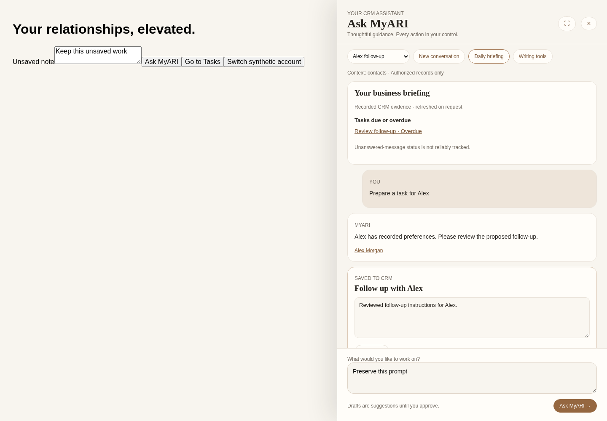
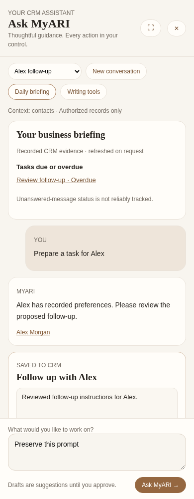

# Ask MyARI — authorized CRM assistant review

Implemented on `feature/authorized-crm-assistant`, building on the pending premium Studio/Activity/Settings work. No configured database migration, production record update, real provider request, communication, campaign activation, merge, or deployment was performed.

## 1. Existing Claude architecture

The application already uses Anthropic Messages over server-side `fetch`, with `ANTHROPIC_API_KEY`, `anthropic-version: 2023-06-01`, and `ANTHROPIC_MODEL` defaulting to `claude-sonnet-4-5`. Claude was retained. No new AI provider or SDK was introduced.

The previous Ask MyARI surface was a task selector in a modal calling `/api/ai/generate`: seven user-facing draft tasks plus relationship-pulse generation, task-specific JSON prompts, existing JSON normalization, and deterministic template fallback. Existing independent Claude features include Tasks proposals, Notes assistance, Voice Studio writing, Activity insights, and Brand Kit assistance. These specialized workflows remain available. The original drafting surface is accessible through **Writing tools**.

Previously there was no general conversational CRM tool loop, server conversation storage, persisted approval queue, or authenticated page-record resolver. An unused older AI shell still presented placeholder controls/sample metrics; it now opens the real assistant without invented counts.

## 2. Existing features preserved

- Structured email subject/body, SMS, voicemail, note summaries, follow-up suggestions, campaign ideas and existing campaign idea actions.
- Existing routes, Clerk sign-in, subscriber ownership, APIs, form state, provider integrations, consent/suppression and live-outbound guards.
- Closing/reopening the assistant preserves its unsent prompt/results/edits and does not remount the page editor. Account changes intentionally clear the entire assistant scope.

## 3. New read-only capabilities and data sources

All tools run server-side under the authenticated personal subscriber ID. There is no model-supplied owner/workspace argument, SQL, arbitrary table/column selector, external URL fetcher, secret/configuration tool, or mutation tool in Claude's tool registry. Existing architecture uses personal ownership; shared-workspace access is not inferred from roster entries.

| Tool | Authoritative source / scope |
|---|---|
| Contact search | Existing `readContactSnapshot`, own contacts, name/email/phone matching; returns minimized fields |
| Opportunities | Same snapshot and `contactSegment(type) === active-lead` definition as Contacts; no invented pipeline value |
| Contact activity | Own `engagement_events`, optionally scoped to a verified contact |
| Campaign details / sequence | Own `campaigns` / `campaign_steps`, actual statuses/order/channel/delays |
| Delivery events | Own `outbound_delivery_events`; explicitly bounded events, not inferred delivery rates |
| Delivery statistics | Existing `readDelivery` + `summarizeDelivery`, message-level deduplication and verified event rules |
| Tasks | Own `contact_tasks`, actual due/completion/notes |
| Appointments | Own `calendar_events`; clearly local records, no claim of live Google synchronization |
| Notes | Own `contact_notes`; bounded excerpts treated as untrusted evidence |
| Property preferences | Own contact budget/area/property type/sqft/beds/baths/garage/lot/address fields; absent values remain absent |
| Transactions | Own `task_transactions` plus owned milestone tasks, actual completion/missing records and expected closing dates |
| Financing reports | Own `financing_reports`, saved calculation inputs/results/context; no invented rates or forecasts |
| Voice drafts | Own `voice_script_drafts`; saved script text only, never implicit unsaved audio/text upload |

Tool results generally return up to 25 records with matching counts and explicit truncation. Counts are never calculated from a truncated sample. Full delivery statistics use the established paged evidence read. Tool outages report unavailable rather than zero. References and internal links are generated by server tools; unknown cited IDs and action contact IDs are rejected. Actual ownership is checked again while saving/approving.

## 4. Confirmed bugs repaired

- Legacy generate endpoint accepted a selected contact ID alongside unrelated browser-supplied names/notes. It now verifies ownership and loads that selected contact's name/notes server-side.
- Legacy Anthropic requests had no timeout and logged raw provider error bodies. Requests now time out and log only HTTP status.
- Legacy fallback copy implied prior engagement without evidence. It now avoids those assertions and the UI labels template fallback explicitly.
- Legacy writing could display a response for a stale selected task/contact. Request-generation guards discard stale results.
- The original modal cleared result state on close/reopen; results now survive while task/contact changes still reset them.
- New conversation turns initially shared transaction timestamps. A database identity position now gives deterministic user/assistant ordering.

## 5. Approval workflow

Claude can propose ten validated kinds: tasks, reminders, campaign drafts, SMS/email drafts, voice scripts, contact notes, appointment proposals, mortgage comparisons and branded flyer requests. Email requires a subject; SMS is capped at 320 characters during generation and draft editing; tasks/notes/reminders require a verified owned contact, and reminders require an explicit timestamp. Task notes respect the existing 2,000-character limit.

Proposals are stored before any CRM mutation. Subscribers may copy, edit and persist draft text/subjects. Editing uses a locked compare-and-swap against the original proposal and is blocked after approval/dismissal. Approval stays disabled until edits have been saved. A separate review and **Confirm save / Confirm draft approval** step approves the exact stored version. The browser cannot submit an arbitrary action payload to the approval endpoint.

- **Tasks / reminders / contact notes:** confirmed approval atomically creates the internal CRM record and audit entry and marks the proposal saved. Existing database guards apply. No calendar/provider sync is called; a reminder is a recorded task reminder, not a dispatched notification. Row locking and persisted record IDs prevent duplicate records on retry.
- **Campaign, SMS/email, voice, appointment, financing and flyer requests:** approval stores an **approved review draft only** in the assistant queue, with copy/edit and workspace links. It does **not** create a canonical campaign/script/appointment/report, populate every destination form, send a message, or publish a flyer. The UI explicitly distinguishes these from completed saves. Use the existing specialized workspace to finish these higher-impact workflows.

Live sends, enrollment, campaign activation, record deletion and automation changes are deliberately absent from the assistant's execution surface. These remain in existing independently authorized workflows.

## 6. Context and experience

Warm ivory/champagne drawer with serif headings, expandable width, suggestions, server conversation list, source links, editable structured action cards, explicit proposal states, loading/error feedback, keyboard focus trapping/Escape/restore and mobile layout. Selected IDs are registered from Contacts, Campaigns, Tasks, Notes, Property Finder, Financing and Voice Studio; contact/campaign profile routes and supported URL IDs also resolve server-side. The model never receives browser-supplied contact names, note contents, or unsaved editor text implicitly.

Mortgage assistance reads **saved financing reports** through its authorized tool. An unsaved on-screen calculation is not silently transmitted or guessed; the assistant must request missing inputs or a saved report. Calendar suggestions operate on authorized locally recorded appointments. Cross-tab page context updates independently of conversation history.

## 7. Optional daily business briefing

On-demand, evidence-based briefing has no scheduled background job or automatic provider call. It reads due/overdue tasks, appointments in the next 24 hours, recent failure events, campaign engagement events, and transaction checklists/recorded closing dates, with counts, limits, source links and separate source outage states. No legal deadline or activity is inferred. This deterministic evidence view costs no Claude request.

**Unanswered messages remain explicitly unverified:** existing communications do not reliably correlate every inbound message with a subsequent outbound reply. The briefing directs users to the actual inbox instead of inventing an unanswered count. Expected closing dates are not legal deadlines. Checklist views contain full milestone progress; the assistant does not infer completion from a saved stage label.

## 8. Security and usage considerations

- Clerk authentication on each endpoint; every query and database approval operation is owner-scoped. Private tables use RLS plus browser-role revocation; service-only functions use invoker privileges.
- Tool instructions explicitly treat CRM text/documents/history as untrusted evidence. The strongest boundary is architectural: no unrestricted access or execution tools exist. Prompt text alone is not claimed to eliminate all model hallucinations or injection attempts.
- Fixed query allowlist, schema validation, source-ID validation, credential-pattern redaction, no raw HTML rendering or arbitrary model-generated record URLs. No provider payload/key or customer prompt is written to audit logs. Redaction is defense in depth, not a DLP guarantee.
- New assistant: atomic 20 request attempts/hour and 100/day per subscriber; failure to enforce limits fails closed. Up to four model rounds, eight requested read-tool calls, 2,000 output tokens/round, twelve history turns, 3,000-character user prompts, bounded tool excerpts, and a 45-second provider deadline.
- Successful usage audit records model/input tokens/output tokens/tool-call count, not message contents. Failed requests still consume attempt budget; partial failed-provider token usage is not a complete billing ledger. Anthropic invoices remain authoritative. No dollar estimate is fabricated.
- Existing specialized AI endpoints retain their previous budgets; consolidating plan-based quotas across every separate AI feature requires follow-up. The new limit is not a paid-plan entitlement engine.
- Request IDs preserve completed exchanges on retries; approval/revision locks prevent duplicate or stale saves. Provider failures require an explicit user retry; no blind paid retry loop.
- History is stored server-side in private owner-scoped tables. Only the last 12 turns are sent to Claude, last 50 loaded in a selected conversation, and latest 30 conversations listed. Automatic retention/deletion UI and a cross-feature organization authorization model are not added here; review retention/provider data-processing policy before release.

## 9. Validation and screenshots

Synthetic owners and mocked external providers only. No production data was queried or changed.

- `npm run test:assistant`: model protocol, bounded loops, malformed/empty/provider failures/timeouts, email/SMS shapes, actual lifecycle counts, missing data, foreign records, invalid tools, unauthorized references, approval-only mutation and briefing rules.
- `npm run test:assistant-db`: actual new migration plus existing Notes/Tasks migrations in isolated PostgreSQL/PGlite; service-role execution, cross-account rejection, no pre-approval writes, exact editable proposals/conflicts, idempotent tasks/notes, draft-only email, dismissal, changed contact ownership, usage caps and browser privilege denial.
- `npm run test:assistant-browser`: actual React components with synthetic API at 1440/1920/768/390px; selected ID context, editable proposals, separate confirmation, history reload, stable retry IDs, safe errors, unsaved page/prompt preservation, account reset, Escape and no horizontal body overflow.
- Existing full unit suite, security checks, regressions, TypeScript, lint and production build results are recorded in the task delivery. Existing unrelated lint warnings are not represented as new fixes.

See `browser-results.json`. These captures demonstrate the actual drawer over an isolated fixture, not an authenticated production or staging session.

## 10. Production readiness / staging instructions

**Ready for code and synthetic UI review; not ready to release to subscribers yet.**

1. Review/apply `20261028000000_ai_crm_assistant.sql` to confirmed non-production staging only, after the existing Notes/Tasks/Studio/Delivery/Financing prerequisite migrations. Nothing has been applied to the configured database.
2. Configure and verify staging `ANTHROPIC_API_KEY` / supported `ANTHROPIC_MODEL` and provider network access. Current managed environment is operational but its enforced outbound policy does not allow `api.anthropic.com`; real Anthropic, Clerk staging sessions and subscriber/provider data were not exercised.
3. Keep live outbound disabled. Authenticate two synthetic staging subscribers and repeat tool/approval/history/isolation checks with real staging auth/database roles. Verify UI context in each actual workspace, saved task/note refresh, accurate source states and safe unsupported workflow handoffs.
4. Review AI data-processing/retention rules, provider billing alerts, plan limits and the explicitly incomplete cross-feature quota/unanswered-message/destination-prefill capabilities above.
5. Obtain explicit approval before any production migration, merge/deployment or release. No production records, provider credentials, webhooks, campaign schedules or communications were changed during QA.

### Principal changed files

- `lib/ai/assistant/{schema,tools,claude,privacy,briefing,http}.ts`
- `app/api/ai/assistant/{route.ts,actions/route.ts,briefing/route.ts}`
- `components/ai/{crm-assistant-drawer.tsx,crm-assistant.css,ai-assistant-sidebar.tsx,ai-assistant-context.tsx,legacy-draft-generator.tsx}`
- Stable-ID context registration in Contacts, Campaigns, Tasks, Notes, Property Finder, Financing and Voice Studio; record-refresh listeners in Tasks/Notes.
- `components/crm/ai-assistant-shell.tsx`, legacy `app/api/ai/generate/route.ts`, `lib/ai/{generate,prompts}.ts`.
- New private SQL migration; assistant unit/database/browser tests and scripts; review artifacts; release/staging/security/demo documentation.
