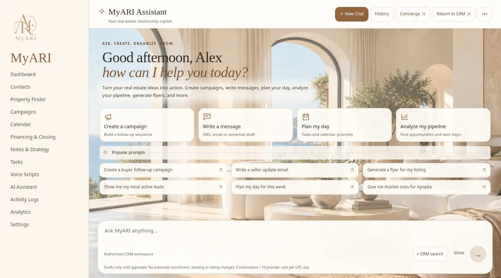
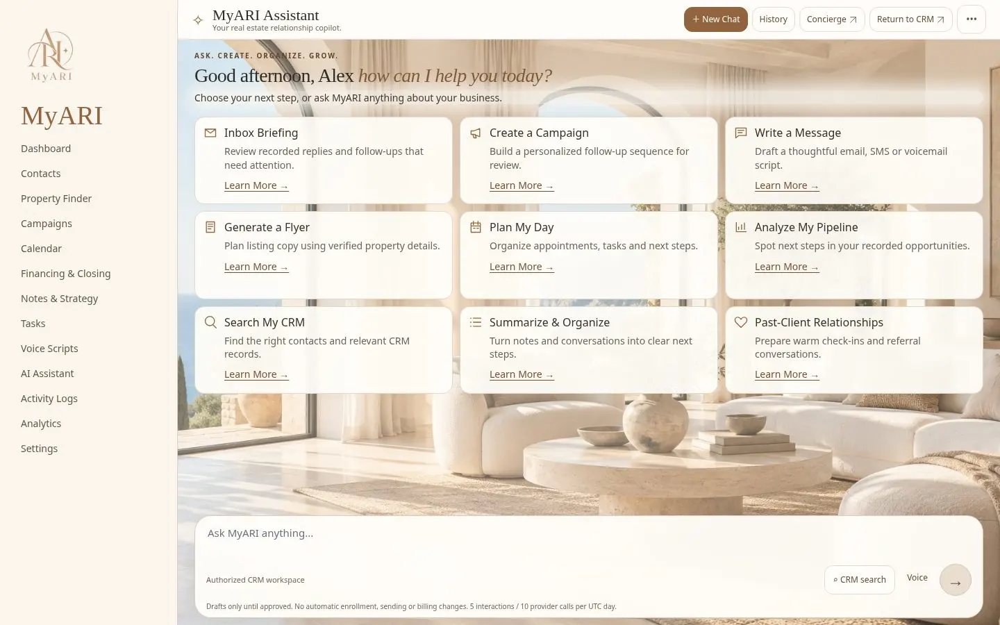
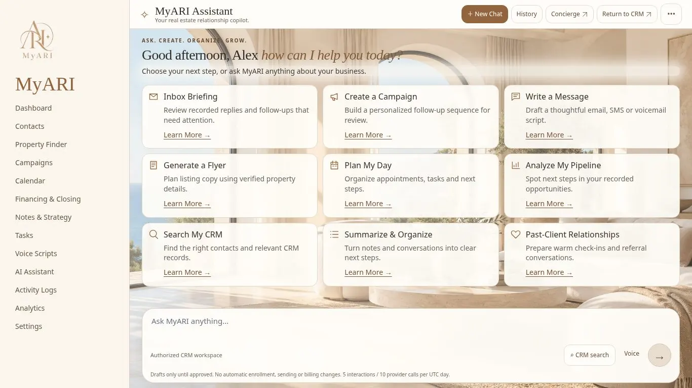
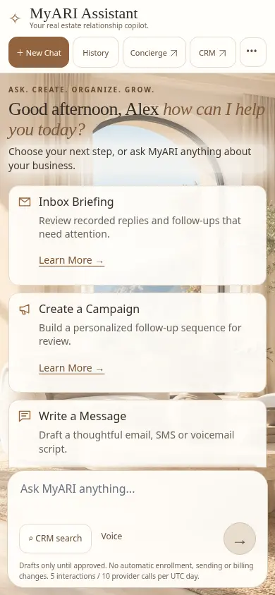
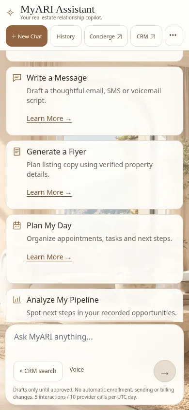
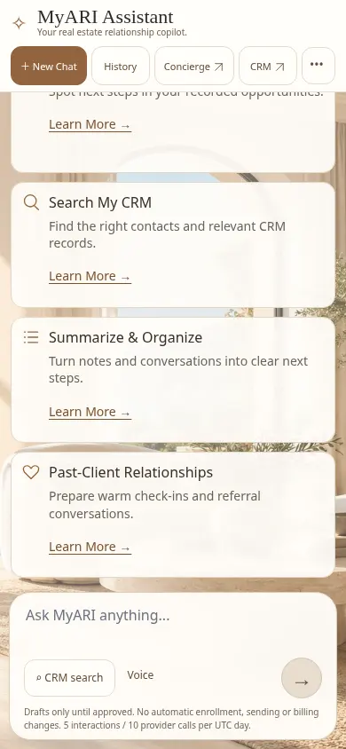

# Compact Assistant welcome workspace

The welcome view exposes all nine supported Assistant capabilities in a three-by-three desktop grid. Each card has a 16px title, 14px description, a prompt-preparation action and a visible 14px Learn More button. Explanations describe actual supported behavior, limitations, authorization and approval safeguards. Starting an explanation prepares/focuses the composer; it does not spend an AI call or send a message.

## Before and after

| Measure | Previous | Compact |
| --- | --- | --- |
| Desktop header, unchanged markup with previous/current styles | 82.34px | 57px (31% smaller) |
| Main welcome actions | Four primary cards plus popular prompts | Nine equally sized cards with descriptions and Learn More |
| 1440×900, 1366×768, 1280×800 | Prior layout used a larger greeting and secondary starters | All nine cards, descriptions, Learn More links and composer visible; no inner or outer welcome scrolling |
| Tablet | Prior starter layout | Two columns; slight internal scroll at 1024×1000, none at 768×1024 |
| Mobile | Prior starters | One column, inner scrolling and a persistent composer; 44px Learn More targets |
| Short desktop 1440×600 | — | 137px internal welcome overflow; zero outer-page overflow; composer visible |

The original coastal scenery, warm overlays and serif identity remain. On the first submitted message, the greeting/grid disappear immediately. Existing conversation restoration, separate conversation scrolling and follow-new-messages behavior remain intact. There are no changes to Assistant APIs, proposal digests/replay protection, CRM permissions, usage limits, billing, sending or Concierge access.

## Verification

- 402 Node assertions passed; security verifier and optimized build passed; affected TypeScript/lint clean.
- 386 browser checks across eight standard viewports, plus 49 checks at 1440×600. The reproducible browser matrix now includes all nine viewport cases.
- All nine explanations and Start actions tested without making AI calls. Native modal keyboard Enter/Escape and focus return tested.
- Existing persistence, campaign revisions/approval/rejection, tenant denial, error recovery, modes/Claude navigation and history checks passed with synthetic providers/CRM.
- Automated axe checks detected no violations in the tested desktop/mobile states; this is not a full manual accessibility certification.
- Capability explanation opening measured 8–22ms to an open dialog/animation frame in the local browser. This is a synthetic timing measure, not field INP. Details: [measurements](measurements.json).
- Hosted credential isolation is checked privately at build time. A signed-in owner review of the fresh protected Preview remains separate from mocked browser acceptance.

## Screenshots

The before image was recorded at 1440×800; desktop after images use the requested viewport sizes. Header style measurements use identical header markup at matched viewport sizes.

Before:

1440×900:

1366×768:

Mobile 390×844, top/middle/bottom demonstrate the complete nine-card inner scroll while keeping the composer visible:

Preview only. No Production merge or deployment is authorized by this work. Revert the compact UI commit to restore the prior welcome layout; no database rollback is required.
