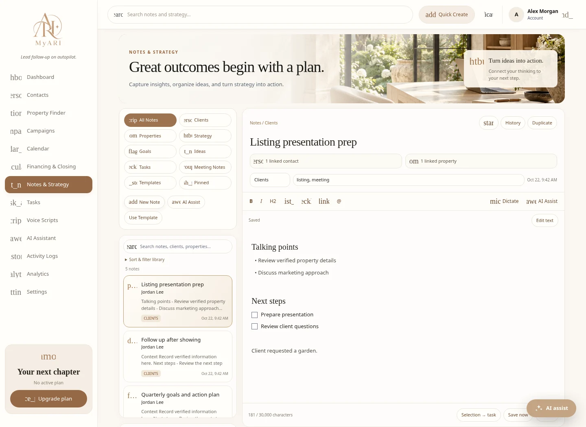
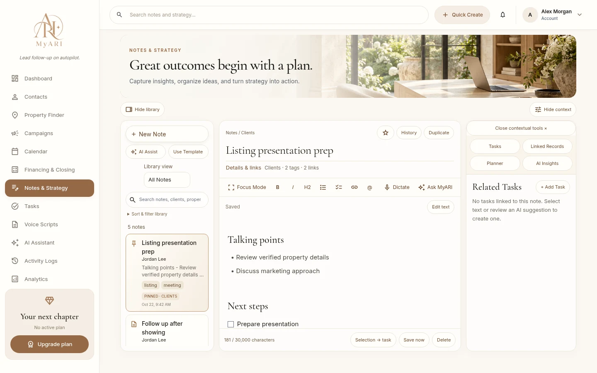
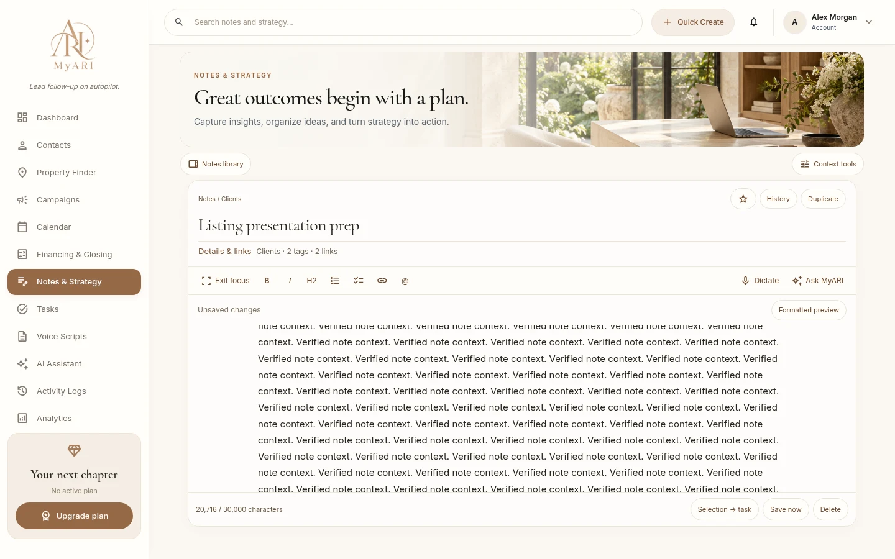
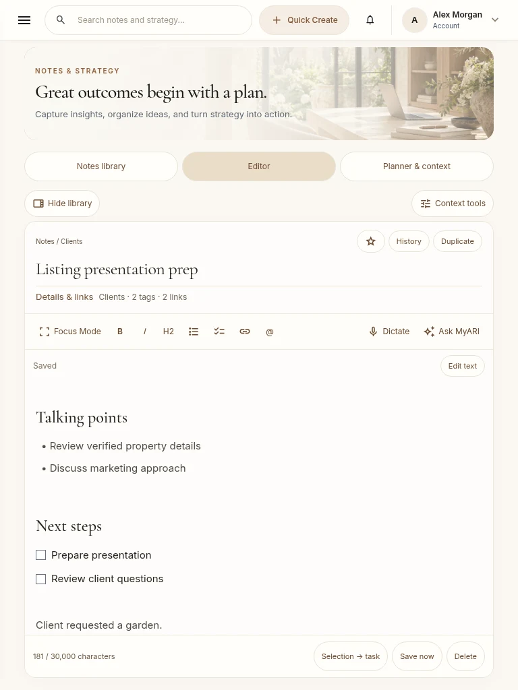
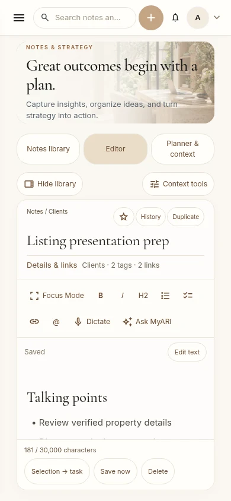

# Notes & Strategy 2 — luxury writing workspace

Development branch: `feat/notes-strategy-2`, stacked on the reviewed Assistant workspace revision `89cfee499f5533b069ab0e21cb2b87ad6ca2fd92`. No Production merge, deployment, SQL, sending, billing or Concierge activation is included.

## Layout and writing behavior

- Keeps the existing botanical office hero, headline and supporting copy; desktop hero is 152px (previous 200px minimum, 24% smaller).
- Compact library with New Note, all ten categories in one selector, search, combined filters, sorting, pins, tags, saved templates and independently scrolling items.
- Central editor with collapsed metadata, existing Markdown storage/formatting, dictation, save state, pin, history and contextual Ask MyARI. Existing notes open in rendered view; new notes and recovered drafts open for editing. There is no HTML/Markdown round-trip conversion.
- One context panel with keyboard-operable Tasks, Linked Records, Planner and AI Insights tabs. Existing planner logic, contact/property navigation and approval dialogs are reused.
- Both workspace panels collapse independently. Focus Mode closes both and restores the prior arrangement on exit. The global MyARI navigation remains. Owner-keyed local preferences persist; the editor DOM, draft, selection and scroll are retained during toggles. Native keyboard controls and reduced-motion behavior remain available.
- Desktop panels scroll independently. Tablet uses a dismissible context drawer. Mobile switches library/editor/context surfaces without unmounting the editor. The generic dashboard bottom spacer and floating AI launcher are suppressed only on Notes, keeping the integrated controls accessible.

## Before and after

| Before | After |
| --- | --- |
| Stacked category buttons and support cards produce a long page | Compact library and one tabbed context panel |
| Raw Markdown is the initial reading surface | Rendered headings, paragraphs, checklists and safe links; explicit Edit text |
| Fixed-height editing area ends early | Viewport-bounded writing surface; panels collapse to expand it |
| Context tools require scrolling through several cards | Tasks, Linked Records, Planner and AI Insights tabs |
| No independent library focus preference | Per-account panel preferences and Focus Mode |

Before: 

Desktop: 

Focus: 

Tablet: 

Mobile: 

Screenshots use actual React components and MyARI assets/fonts with synthetic HTTP fixtures; they are not authenticated hosted acceptance evidence.

## Validation

- Final full Node unit suite: 409 tests passed, including the seven new Notes 2 API/security tests now included in `test:notes`.
- Existing Notes browser regressions passed: editing, saved templates (including legacy schema), dictation denial/recovery, original transcript retention, approved tasks, AI consent/review, formatting, mentions, combined filters, history restoration, pins, deletion, planner views, failed-save recovery, CAS conflict, second session and account switching.
- New browser matrix passed at 1440×900, 1366×768, 1280×800, 1024×900, 768×1024 and 390×844: independent panels, Focus Mode, exact long-note text/selection/scroll preservation, persisted preferences, tab keyboard navigation, metadata, campaign linking, confirmed history restore and no outbound/billing calls.
- Axe WCAG A/AA checks pass on tested initial Notes states at all six viewports; not a comprehensive manual accessibility certification. Low-contrast legacy status labels were corrected.
- Zero horizontal or outer-page overflow in the six initial layout states. Shorter viewports may scroll gracefully rather than clip controls. See `luxury/measurements.json` for geometry and synthetic long-note timing; these measurements are not field INP.
- Actual SQL migrations passed isolated PGlite/PostgreSQL testing for history/CAS, tags, cross-owner links, task retries, privilege denial and transaction rollback. These tests use no live credentials.
- TypeScript, affected-file ESLint, security verifier and the final optimized Next.js build pass.

## Schema and preservation

The foundation `20261023030000_notes_workspace.sql` was owner-approved and applied to test project `jojgdfpmaxvbhobjrsbm` only. Baseline counts and existing-row fingerprints matched independently; see [staging foundation evidence](STAGING-FOUNDATION.md).

The extension `20261030163255_notes_strategy_2.sql` is prepared and tested locally but **unapproved and unapplied**. SHA-256: `cf64d7faa8a54c32a19f444e64a53a4cf2ca17d5b1d47bdd80961295eeb15245`. It adds owner-scoped tag catalog/RPC, optional editor identity/history contact fields, atomic campaign/task association validation, no-op save protection and task payload retry protection/initial completion. It also revokes direct anon/authenticated access to contact_tasks; Clerk-backed server APIs retain service-role access. A tag deletion RPC removes only the selected owner's tag/catalog associations when explicitly invoked, preserving prior note versions; migration application does not invoke it.

The refinement itself requires no further schema change. History reads tolerate foundation-only columns, and open task creation falls back only on a definitive PGRST202 missing-v2-function response. Timeouts and ambiguous errors are never retried. Advanced catalog rename/delete and initial completed-task creation require the pending extension. Existing tasks can still be completed in Tasks.

No independent transaction/opportunity tables were verified; no fictional selectors are introduced. Properties remain authorized contact property addresses. Campaign/task selection currently lists the latest 1,000 owned records; broader search pagination remains a limitation.

## AI and hosted limitations

The existing Notes Claude consent/review flow is reused. It has not been replaced with a new provider, entitlement policy or automatic-save mechanism. Real AI generation is not certified by fixture tests. Anthropic remains intentionally empty in the isolated Preview configuration; live summaries/drafts require an authorized provider setup. AI tag recommendations are not implemented by the current Notes provider, and the interface explains that dependency instead of offering a fake tag-generation action. Existing Assistant authorized note-retrieval tools are unchanged.

## Protected Preview boundary

101 safe nonsecret/empty provider-blocking overrides were created only for Preview → `feat/notes-strategy-2`: test Supabase URL, sending/billing/public/Assistant/Concierge flags off, empty allowlists, blocked production integrations/schedulers and safe local auth routes. Metadata listing is truncated at 100 entries; effective runtime isolation is therefore not yet certified. No secret values were read, copied or exported. No invalid secret placeholders were created.

The connected API cannot securely duplicate Secrets from another branch. Required secure dashboard entries on **Preview → feat/notes-strategy-2 only**:

| Variable | Type | Source |
| --- | --- | --- |
| NEXT_PUBLIC_CLERK_PUBLISHABLE_KEY | Config | Clerk Development instance |
| CLERK_SECRET_KEY | Secret | Matching Clerk Development instance |
| SUPABASE_SERVICE_ROLE_KEY | Secret | Supabase test project jojgdfpmaxvbhobjrsbm |
| OPENAI_API_KEY | Secret | MyARI-Staging OpenAI project |

Do not paste credentials into chat. Existing entries on other branches and Production must remain untouched.

Automatic Git deployments for this branch are disabled in vercel.json. A fresh protected deployment must wait for isolation checks. Its deployment-only Build Command should run `node scripts/notes-preview-isolation-check.cjs --commit=<reviewed SHA> && npm run build`. That private check verifies exact Preview branch/project/revision, disabled controls, unexpected credential names, Clerk Development pair, test service-role authentication and read-only OpenAI model authentication; it logs only sanitized results. No new public diagnostic endpoint exists. A signed-in hosted owner review remains required afterward. No Preview URL is claimed until that succeeds.

## Rollback and release

UI rollback: revert this feature branch/PR to its parent; never delete Notes data to undo styling. Production schema is not approved. Before a future Production schema request, verify actual dependencies, current backup/recovery evidence and pre/post existing-record baselines. The migrations use transactions; failures before COMMIT roll back. After successful application, retain history/tag data and prefer a reviewed forward fix or function rollback. Do not drop populated columns/history tables, blindly restore a backup or discard post-backup CRM changes. No restore has been initiated.
