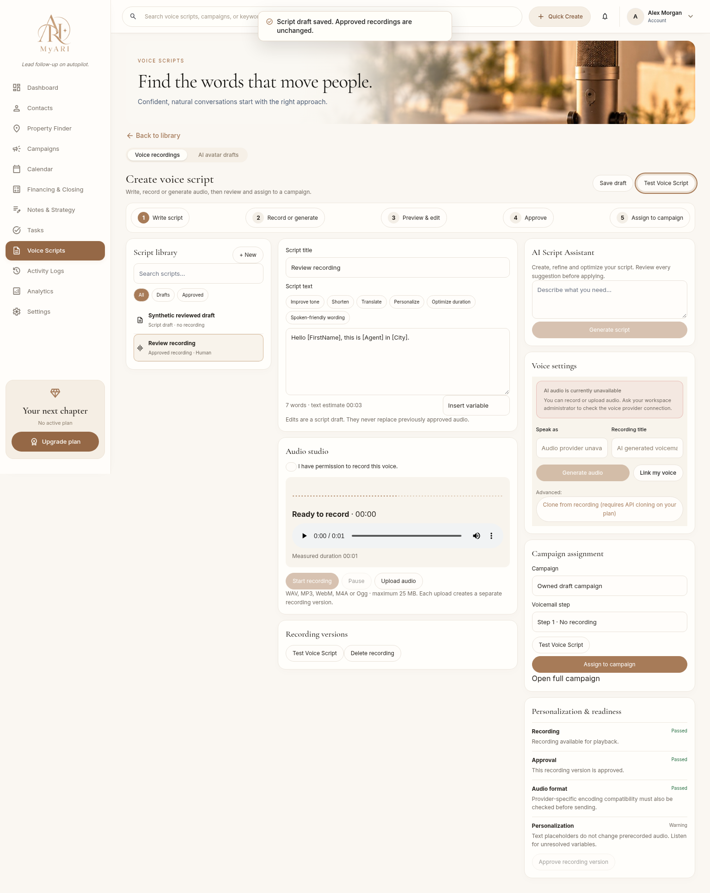

# Premium Voice Studio, Activity, Settings and Brand Kit review

These changes are ready for code/design review, **not production release**. Screenshots use isolated synthetic records and mocked services. No production records, provider configuration, subscriptions, real messages or calls were changed during QA. No authenticated non-production account was available for staging verification.

## Visual review

The shared editorial hero preserves each tab's approved wording. Tasks uses a new coastal desk photograph with explicit `object-fit: cover`; Activity and Settings have separate original photographs. The original MyARI logo, tagline, sidebar destinations and authentication remain.

| Workspace | Desktop (1536px, matching references) | Mobile (390px) |
| --- | --- | --- |
| Tasks | [Desktop](../tasks-workspace/tasks-1536.png) | [Mobile](../tasks-workspace/tasks-390.png) |
| Voice library | [Desktop](voice-library-1536.png) | [Mobile](voice-library-390.png) |
| Create script | [Desktop](voice-create-1536.png) | [Mobile](voice-create-390.png) |
| Activity | [Desktop](activity-1536.png) | [Mobile](activity-390.png) |
| Settings profile | [Desktop](settings-1536.png) | [Mobile](settings-390.png) |
| Brand Kit | [Desktop](brand-kit-1536.png) | [Mobile](brand-kit-390.png) |

Captures also cover 1440px, 1920px and 768px. Tasks before images remain in `docs/tasks-workspace`. Other captures show the implemented result, not authenticated staging or a pixel-perfect reproduction of a populated reference. Sample contacts, percentages, team members and plans from the mockups are not application defaults.

## Completed improvements and confirmed repairs

### Tasks

- Corrected the nested hero image's missing fit rule, replaced the garden image with a coastal office and aligned desktop row columns.
- All eight templates now have individual, actionable real estate instructions and relevant proposed offsets. Buyer/listing closing milestones use an optional actual closing date and otherwise remain undated. Dates still require review; no legal deadline is inferred.
- Preserved task editing, selection, views, approved template assignment, dependencies, dictation, AI review, linked records and existing subscriber-derived counts.
- Fixed Property Finder's new-task link so a client without a property address does not become an invalid property association.

### Voice Studio and campaign previews

- Replaced the stacked Create Script screen with a compact library/editor/tools workspace and a five-stage navigation guide. Preserved browser recording, pause/resume, uploads, native playback and existing voice-provider controls.
- Draft text persists through owned server records. Each upload/synthesis creates a separate recording row; edits do not overwrite approved audio. Approved content metadata is immutable. Approval records the user and timestamp.
- Added one shared, read-only Test Voice Script modal to the studio/library, campaign preview sequence, campaign flow cards and recording-selection modal. Opening it never sends, enrolls, changes schedules or bills.
- Preview resolves supported variables against explicitly synthetic values, lists missing/unsupported placeholders and distinguishes text preview from prerecorded audio. Recipient-specific spoken personalization is not claimed.
- Audio duration comes from the audio element. Waveform peaks come from browser-decoded audio; unavailable decoding is labeled. Removed title-hash durations, invented transcript timestamps, generic AI assessments and fabricated usage history.
- Selecting a campaign no longer assigns audio; assignment requires an exact voicemail step, prior approval and explicit confirmation. Removed automatic approval and implicit campaign metadata reassignment.
- Added MIME/size checks, correct M4A extensions, upload timeouts, incomplete-upload handling, file-container checks before approval and recording-stream cleanup. Failed microphone saves retain the take for retry/download instead of claiming an ephemeral blob URL was saved permanently.
- Assigned recordings cannot be deleted silently. Recording reads and usage checks page through all owned rows. Stale account requests cannot overwrite the refreshed library.
- Added structured AI writing proposals with validation, timeout/failure handling and review before applying. Static AI audio generation rejects unresolved placeholders. Cloning requires explicit permission confirmation.

### Activity & communications

- Added compact clickable KPIs, Business/System separation, combined filters, pagination, dense date-grouped rows and a right-side event panel with real record navigation.
- Interactions Today counts loaded non-system business events on the browser's local date; Client Replies counts recorded `replied`/`callback` engagement events; Needs Attention counts undismissed alerts; Campaign Activity counts campaign audit and delivery events. These are event counts, not distinct contacts or an estimate of unobserved communications. Other filters retain their explicit range. No trends are invented.
- Audit and engagement reads are fully paged and owner scoped. Delivery statuses use the existing Delivery Audit read model; legacy fallback is explicitly limited to the 40 most recent recipient statuses and is not independently verified delivery.
- Added provider-reported inbound call/unmatched-message activity, stored read/dismiss state, batched Mark All Read and safe CSV cells that cannot execute spreadsheet formulas.
- Added evidence-based daily priorities and optional AI insights that must reference and quote supplied owned events. Neither creates tasks or sends messages.
- **Security repair:** the old inbound SMS handler searched contacts across accounts by sender number. The new handler validates Twilio's signature/account and resolves a verified receiving-number registry before looking up contacts within that owner. Ambiguous/unknown senders remain unassociated.
- Added an atomic idempotent inbound RPC for SMS/call receipts. STOP remains suppressed at the owner/phone level even when contact attribution is ambiguous, START does not erase suppression or DNC, duplicate receipts do not repeat engagement, queued campaign steps stop under the existing stop-after-reply policy, and final live authorization rechecks replies/enrollment.
- Added a separate call-status callback endpoint; it does not replace incoming-call forwarding TwiML. Parent call completion is not represented as proof an agent answered a forwarded leg.
- Inbox shows recorded inbound SMS/calls and available outgoing SMS Delivery Audit evidence. Keyword classifications are reviewable suggestions and do not independently change consent. Existing contact/task/calendar navigation remains available.

### Settings and Brand Kit

- Added compact Profile / Brand Kit / Workspace / API Keys / Team / Integrations / Billing / Notifications navigation, preserving existing routes and OAuth/billing actions.
- Separated existing integration and notification forms into their own tabs. Profile now has clear save/cancel controls, valid timezone handling, a persisted language preference and actual sign-in-provider photo uploads. Email remains provider managed. Photo changes save immediately, as labeled.
- Removed sample default names, phone numbers, team members, API keys, paid-plan status and enabled-MFA claims. MFA/session management opens the actual sign-in provider. Account-created/verification/last-login details appear only when available.
- Removed the ineffective fake MFA toggle, browser-generated credential claims and the fake invitation-sent message. Team rows are explicitly a roster; ownership cannot be changed through its form. The credential modal no longer asks for secrets it cannot securely provision.
- Added validation, owner-scoped browser caches, account-session remounting, save deduplication and database-serialized optimistic saves. Failed reads cannot be treated as empty settings; stale edits get a conflict instead of overwriting another session.
- Billing saves cannot grant entitlements. Subscription status is read from the mapped, ownership-verified Stripe customer using read-only provider requests. Unknown verification is labeled. Catalog prices are distinguished from actual invoices in Stripe; invented voicemail-minutes calculations were removed.
- Integration credential presence is labeled configured, not proof of a live connection, and fake current-time sync timestamps were removed. Onboarding verifies Twilio number ownership through a read-only provider check and Google authorization through actual calendar discovery before completing those steps.
- Brand Kit supports agent/business/contact details, bio, license/disclosures, social links, colors/fonts, private original-quality JPG/PNG/WebP uploads, replacement/removal from the kit, and optional reuse of an existing profile photo. Server checks owner paths, a 4 MB limit, signatures and decoded dimensions. The private bucket prevents browser enumeration. Removal from the kit does not purge historical assets used by earlier materials.
- Added live, clearly labeled design previews for flyers, mortgage estimates, seller net sheets, signatures and buyer presentations. No property/financial records are fabricated or published.
- Approved saved branding feeds the existing financing report context and report text (mortgage, seller, buyer and offer-comparison reports), including contact/license/disclosure fields. Other features can consume the shared branding service; unsupported outputs are not silently rewritten.
- Preferred partners remain the actual Financing & Closing records, including their branding-authorization state. No partner is invented or endorsed.
- Onboarding derives twelve steps from real account configuration and provider evidence, with progress, links, review acknowledgments and a persisted dismissal. AI setup proposals are editable and require review; they never save licensing or affiliation claims automatically.

## Principal changed files

- UI: `components/tasks/*`, `components/voice-studio/*`, `components/voice-scripts/voice-script-library.tsx`, `components/activity/{activity-center.css,conversation-inbox.tsx}`, `components/settings/{brand-kit-panel.tsx,settings-premium.css,integration-config-modal.tsx,invite-member-modal.tsx}`.
- Pages/layout: `components/pages/stitch/{VoiceScriptsStudioPage,ActivityLogsPage,SettingsWorkspacePage}.tsx`, shared editorial hero and `components/layout/dashboard-shell.tsx`. General AI actions remain available inline instead of covering save controls.
- Services: `lib/{voice-studio,communications,activity,settings}/*`, `lib/hooks/use-voice-assets.ts`, `lib/billing/read-subscription.ts`, financing branding/report context and final send authorization.
- APIs: Voice Assets/Studio, Activity/Communications/Twilio callbacks, Settings/Brand Kit/Onboarding, campaign assignment and Tasks checklist dates.
- Tests: `scripts/{studio-audit,settings-audit,studio-database,studio-browser}.test.cjs`, Tasks regressions and shared synthetic browser adapters. Sharp was already used transitively by Next.js and is now a direct dependency for server-side image validation.
- Migrations: the four reviewed migrations below. No configured database was changed.

## Release gates and remaining limitations

1. Apply prerequisite migrations and these migrations to a **confirmed non-production database**, then run authenticated staging QA:
   - `20261026000000_voice_studio_versions.sql`
   - `20261026010000_activity_read_state.sql`
   - `20261026020000_inbound_communications.sql`
   - `20261027000000_settings_versioned_saves.sql`
   Tasks' advanced workflows additionally require `20261025000000_tasks_workspace.sql`. This is a schema migration supplied with the code, not a paid subscription/database upgrade. Before migration, affected cloud writes return an explicit unavailable state rather than pretending to save.
2. Provision the verified Twilio number/account-to-owner registry only after independently verifying ownership. Configure signed SMS callbacks and the separate **call-status callback** in staging; do not replace existing forwarding handlers. The implementation uses the configured Twilio token; per-subaccount secret selection remains unsupported.
3. No real microphone, live AI/TTS/clone request, provider callback, Stripe invoice/subscription or actual subscriber count was verified. Container-signature validation is not codec/provider delivery certification. A transcription service and spoken per-recipient audio personalization are not implemented. Legacy approvals may lack historical timestamp/source data.
4. This inbox does **not** add a new direct Twilio reply-sending endpoint. It keeps authorized existing workflows and follow-up navigation. Creating a new outbound reply channel, team organization/invitation service or server API-key authentication/rotation/revocation requires separate security review. No unsupported control claims those services work.
5. The existing campaign engine stops outreach after a response; this work preserves that policy rather than inventing configurable rules. Queued stopping is transactional and the final boundary rechecks responses. Already in-flight provider requests cannot be recalled. Forwarded call-leg answer attribution requires provider configuration and additional evidence; no personal-cellphone tracking is claimed.
6. No background email/SMS/push notification dispatcher was added. Existing preferences remain saved; actual delivery depends on the supported existing services. Keyword reply suggestions are not an AI model classification. Provider-side opt-out behavior and notification preferences need staging checks.
7. Brand Kit is integrated with supported financing reports and signature/design previews. Automatic campaign marketing injection, arbitrary email-template rewriting, AI flyer production and every future presentation/export consumer are not implemented. Existing PDFs/materials are not republished. Historical signed image URLs can require refreshed authorized access when reopening old reports.
8. Team role labels remain roster metadata, **not multi-user workspace authorization**. Clerk remains the authentication/access boundary. Billing modifications continue through existing verified checkout/portal routes; no charges, upgrades, downgrades or cancellations were tested.
9. The screenshot viewport and supplied mockups were visually compared. Sparse synthetic fixtures deliberately do not reproduce the mockups' fake populated tables or statistics. Manual authenticated staging accessibility/provider QA remains required.

## Local validation

- TypeScript, the full unit suite, security/regression scripts and production build passed locally. ESLint passed with zero errors and seven pre-existing unrelated warnings. The added suites contain 13 Studio/Activity/security cases and 9 Settings/Brand Kit cases.
- Isolated PostgreSQL/PGlite executes the migrations/functions and checks tenant boundaries, duplicate STOP/callbacks, suppression preservation, queued stopping, call ordering, browser-role denial, optimistic Settings conflicts and retry deduplication.
- Actual-component Chromium tests exercise draft saves, exact-step selection without assignment, safe preview, Activity filters/empty results/details/inbox, Settings tabs/profile saves, Brand Kit edits/approval/persistence, and body/root overflow at 1440/1536/1920/768/390px.
- `browser-results.json` records the responsive results. Screenshots and tests do not prove production data or live provider readiness.

Final security follow-up: synthesis now refuses arbitrary/foreign private provider voice IDs and invalid selected profiles. Voice linking uses an owner-checked serialized claim, including sample-recording ownership, with retry deduplication tested in PostgreSQL. Provider error bodies are not shown as generated content. The configured shared/default voice remains an explicit supported choice.

